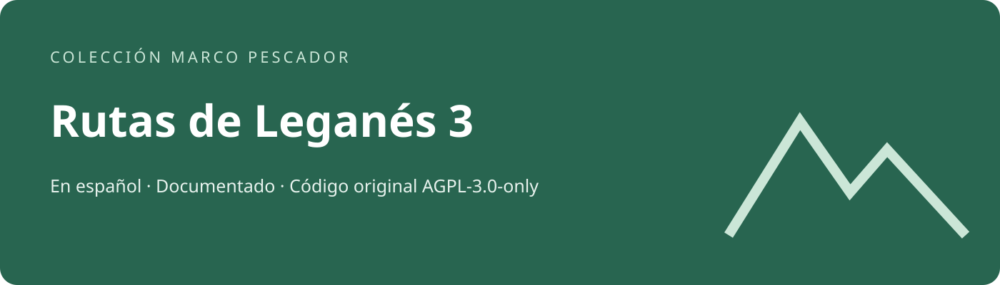
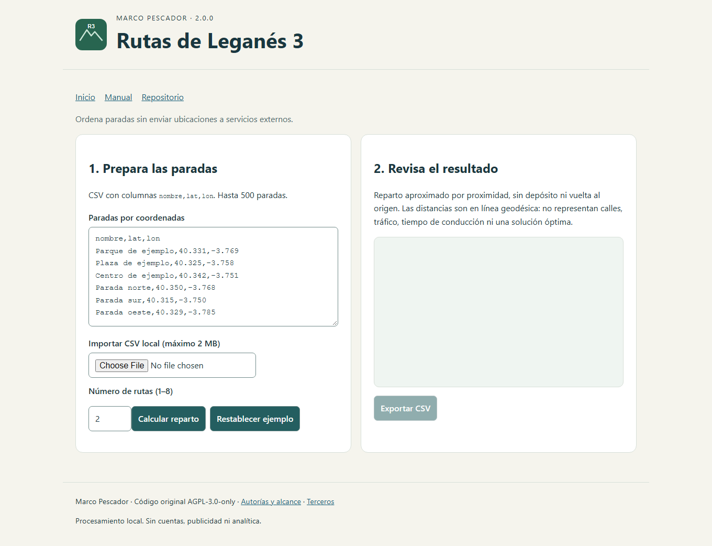

# Rutas de Leganés 3

Planificador local de paradas por coordenadas, sin servicios de pago.

**Autor de la modernización: Marco Pescador.** Interfaz y documentación en español. Código original nuevo: **AGPL-3.0-only**; el material previo conserva sus derechos y autoría.

[Abrir web](https://peskysa.github.io/Rutas-de-Leganes-3.0/) · [Descargas](https://github.com/Peskysa/Rutas-de-Leganes-3.0/releases/latest) · [Manual](docs/MANUAL.md) · [Instalación](docs/INSTALACION.md)

## Qué incluye

Planificador local de paradas por coordenadas, sin servicios de pago. Consulta en el manual las funciones, ejemplos, requisitos y limitaciones de este proyecto.

## Capturas

[Función principal y móvil](docs/CAPTURAS.md).

## Uso e instalación

Sigue [Instalación](docs/INSTALACION.md) y el [Manual](docs/MANUAL.md). Los ejemplos sirven para aprender y probar; no se garantiza su idoneidad para producción.

## Modalidades y descargas

Linux, Windows, portable, web y Android tienen alcances descritos en [Distribución](docs/DISTRIBUCION.md). Cada Release distingue los paquetes compilados de las pruebas realizadas. Android no se considera probado en teléfono físico y Windows no dispone de firma comercial.

## Documentación

[Instalación](docs/INSTALACION.md) · [Manual](docs/MANUAL.md) · [Desarrollo](docs/DESARROLLO.md) · [Privacidad](docs/PRIVACIDAD.md) · [Licencia](docs/LICENCIA.md) · [Terceros](THIRD_PARTY.md) · [Historial](CHANGELOG.md) · [Contribuir](CONTRIBUTING.md) · [Seguridad](SECURITY.md).
